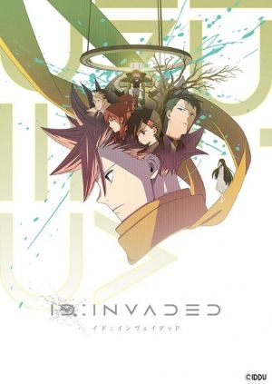

### ID: Вторжение

Аниме представляет собой мрачный психологический детектив и научно-фантастический триллер, где расследование преступлений происходит не на месте происшествия, а в глубинах подсознания убийц.

Специальное подразделение «Кура» обладает революционной системой «Мидзуханомэ», позволяющей её операторам — «пилотам» — проникать в подсознание («Ид») преступников. Это пространство, «мир жажды убийства», — материализация самых тёмных и подавленных инстинктов, намерений и травм подозреваемого. Талантливый, но травмированный детектив Акахито Сакаидо становится одним из таких пилотов. Рискуя собственной психикой, он погружается в эти искажённые миры, чтобы найти зацепки и раскрыть самые жестокие и запутанные преступления.

Основная линия сюжета — это охота на загадочную фигуру, стоящую за серией, казалось бы, несвязанных убийств. Расследуя одно преступление за другим, Сакаидо наталкивается на след Джона Уокера — мифического «создателя убийц», который, словно кукловод, манипулирует людьми, доводя их до грани и пробуждая в них «жажду убийства». Каждое погружение в «Ид» приближает Сакаидо к разгадке, но одновременно и разрушает его, стирая границы его собственной личности и заставляя соприкоснуться с тем же мраком, который движет преступниками.

Сезон строится так, что внешнее расследование идёт рука об руку с внутренним путешествием в безумие. Главный конфликт заключается не в физической поимке преступника, а в интеллектуальной и ментальной гонке по лабиринтам чужих сознаний, где Сакаидо вынужден понять логику безумия, чтобы опередить Джона Уокера и предотвратить рождение новых убийц. Финал сезона подводит к главному вопросу для героя и зрителя: можно ли погрузиться в пучину зла и не утонуть в ней самому?

