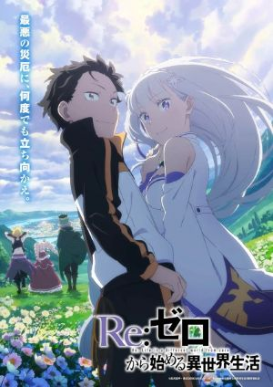

### Re: Жизнь в альтернативном мире с нуля (1, 2, 3 сезон)

Аниме представляет собой глубокую психологическую драму и тёмное фэнтези. За внешним флёром приключений скрывается жёсткое исследование человеческой психики и воли к жизни. В центре сюжета — Нацуки Субару, обычный парень, перенесённый в другой мир и получивший единственную, мучительную способность «Возвращение Смертью» — возвращаться к точке сохранения после гибели. Его история не о победах силой, а о победах духа, цене спасения близких и медленном, болезненном взрослении.

Центральная линия произведения — это не столько спасение мира, сколько спасение отдельных душ от их демонов.

(1 сезон). Субару, полный наивных иллюзий о героизме, сталкивается с жестокой реальностью: его способность обрекает его на бесчисленные циклы смерти и страданий. Первая арка знакомит его с серебряноволосой полуэльфийкой Эмилией и её служанками-демоницами, Рам и Рэм, ставшими ключевыми фигурами в его жизни. Основное развитие сезона — это ломка его первоначального эгоизма и формирование первых ростков ответственности. Через череду мучительных провалов в противостоянии с Убийцей-Потрошительницей Эльзой и с заговором архиепископа Праздности Бетельгейзе Романе-Конти, Субару понимает, что одного желания «быть героем» недостаточно. Кульминацией становится раскрытие глубокой истории Рэм: её прошлого, комплекса неполноценности и безоговорочной преданности, которая становится для Субару эмоциональной опорой и исцеляет его от отчаяния. Его наивность сменяется хрупкой, но уже уверенной решимостью защитить тех, кого он полюбил, ценой собственных мучений. Саркастичные и язвительные реплики Рам и других персонажей оттеняют его неопытность, добавляя истории остроты.

(2 сезон). Сезон посвящён тотальному погружению в прошлое ключевых персонажей и преодолению их глубинных травм. Оказавшись в ловушке «Святилища», Субару сталкивается с испытаниями, бьющими по самым больным точкам. Главная тема — противостояние с собственным прошлым и принятие себя. Центральными становятся:

- Прошлое Эмилии: Раскрывается её трагическое детство, комплекс вины и страх перед собой, которые мешали ей пройти Испытание.

- История Гарфиэля Тинзеля: Его ярость и фанатизм оказываются следствием глубокого чувства вины за гибель матери.

- Трагедия Беатрис: Её 400-летнее одиночество, связанное с обетом перед Ведьмой Алчности Ехидной, становится одной из самых сильных эмоциональных арок сезона. Её решение нарушить договор и выбрать собственную судьбу — ключевой момент сезона.

Развитие Субару, здесь, — это переход от самопожертвования к ценности собственной жизни. Ведьмы, особенно Ехидна, выступают в роли странных психотерапевтов, заставляя его признать свои слабости, принять помощь других (как в случае с верным другом Отто) и понять, что его жизнь так же важна для близких, как и их жизни для него. Он учится быть не мучеником, а стратегом, опирающимся на союзников.

(3 сезон). Сезон фокусируется на масштабном конфликте в Водном городе и завершении личных историй второстепенных персонажей. Если предыдущие сезоны были сфокусированы на внутреннем мире героев, то здесь акцент смещается на внешнюю угрозу — архиепископов Регулуса (Гордыня) и Сириус (Гнев). Развитие Субару минимально; он следует завету ведьм — ценить свою жизнь, пытаясь действовать более расчётливо. Основная ценность сезона — в завершении арок других героев:

- Рыцарь Вильгельм ван Астрея: Находит окончательное утешение и завершение своей истории любви и мести, связанной с Белым Китом и погибшей женой Терезией.

- Гарфиэль: Находит свою мать, потерявшую память, и через заботу маленькой зверолюдки Мими учится залечивать свои раны и обретает новую семью.

- Отто: Полноценно раскрывается как верный и незаменимый союзник, чьи деловые и дипломатические навыки не раз спасают положение.

Несмотря на обилие экшен-сцен, которые могут показаться избыточными, сезон выполняет важную роль — он показывает, как ранее травмированные персонажи обретают покой и новую опору, в то время как Субару из «спасателя» превращается в часть слаженного механизма своей команды. Остроумие и сарказм, остаются визитной карточкой, не давая мрачной атмосфере полностью поглотить повествование.

