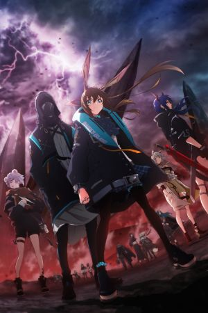

### Аркнайтс (1, 2, 3 сезон)

Формально «Аркнайтс» представляет собой фэнтези-экшен с тактическими битвами, но в своей глубине содержит масштабную социально-психологическую драму и философскую антиутопию. В её центре — фундаментальный конфликт между системной жестокостью и личным выбором в мире, где сама основа цивилизации является смертельной болезнью. Мир Терры, движимый кристаллами ориджиниума, которые одновременно дают энергию и несут смертельную болезнь — орипатию, становится аллегорией общества, построенного на эксплуатации и страхе «инаковости». Здесь заражённые — не монстры, а жертвы прогресса, а борьба за их права обретает трагическую и кровавую многогранность.

«Прелюдия к рассвету»: Точка невозврата и цена наивности

Первый сезон закладывает контуры войны, в которой нет правых, есть лишь сломанные и отчаявшиеся. Молодая Амия и Доктор, страдающий амнезией, руководящие фармацевтической компанией и частной армией «Родос», верят в возможность остановить войну посредством излечения орипатии. Их противники — радикальное движение «Реюнион» — это не орда злодеев, а ответная реакция на геноцид. Сезон исследует крах наивного гуманизма: герои «Родоса» сталкиваются с тем, что их готовность к миру воспринимается как слабость, а каждая попытка спасти (как детей-заражённых Алекса и Мишу) заканчивается трагедией, лишь подпитывающей ненависть.

Амия впервые осознает, что слепая вера в спасение каждого, сталкивается с личным выбором тех, кто не желает спасения. И тогда эта вера, которой она наделила, лишь ожесточает того, кто в ней разочаровался. В таких условиях вера превращается в ловушку: продолжать стучаться в закрытые двери — значит терять близких; отказаться от попыток — значит оставить кого-то навсегда утонуть в его ярости. Наивность через болезненный урок сменяется осознанием: желание биться за спасение имеет свою черту, за которой остается только решительность остановить врага. «Прелюдия к рассвету» заканчивается не началом войны, а осознанием её неизбежности — рассвет откладывается, уступая место длительным сумеркам.

«Зимнее уединение»: Лик благородства во вражеском стане

Второй сезон углубляет деконструкцию конфликта, смещая фокус с идеологии на личные истории. Центральной фигурой становится Фростнова, командир отряда «Йети» в рядах «Реюниона». Её образ — ледяная королева с тёплым сердцем — становится самым сильным аргументом против чёрно-белой картины мира. Фростнова и её бойцы — «лучик солнца во всём гнилом Реюнионе», благородные воины, сражающиеся за свой народ, а не за слепую ненависть. Она желает своего поражения, поскольку видит в Амии стремление к идеалам раннего «Реюниона» — найти убежище для зараженных. Но груз вины и верность своим соратникам не позволяют ей сдаться. Поэтому она мечтает стать ступенькой для роста Амии, чтобы своей гибелью войти в историю, которую та построит. Её трагическая гибель в бою с «Родосом» — не триумф, а величайшая моральная потеря для всех сторон. История Фростновы доказывает, что истинная человечность и честь могут сохраниться именно там, куда официальное общество смотрит с презрением. Её прощальная песня «Lullabye» — прощальный реквием по всем, кого система объявила отбросами, но чьи жизни были наполнены смыслом.

«Восстание из пепла»: Цена победы и бремя памяти

Третий сезон ставит точку в первой дуге, превращая войну в горнило, где переплавляются все идеалы. Конфликт достигает апогея в противостоянии с Талулой и Патриотом, а «Родос» оказывается зажатым между молотом «Реюниона» и наковальней циничных государств, вроде Лунмэня. Победа здесь невозможна без огромных жертв и моральных уступок. Кульминацией становится сцена поминовения павших на «Родосе». Когда в конце длинного списка имен, оплаканных товарищами, звучит имя Фростновы — это акт величайшего признания. Её, бывшего врага, включают в пантеон своих героев. Этот момент символизирует окончательный крах барьера между «нами» и «ими». Пепел сожжённых надежд «Реюниона» становится удобрением для нового понимания, теперь уже твердо доносимого членами «Родоса»: спасение Терры лежит не в уничтожении противника, а в принятии его боли как своей собственной.

Заключение: Свет во тьме и тьма, несущая свет

«Аркнайтс» приходит к сложному, антигероическому выводу: в мире, основанном на несправедливости, чистое добро бессильно, а радикальное зло саморазрушительно. Единственный возможный путь — это мучительное движение в этическом тумане, где союзники могут быть циничными манипуляторами, а враги — вызывать глубочайшее уважение. Финальный выбор Амии, отражённый в её же словах, становится манифестом этой новой, трагической морали: «Если свет, о котором вы говорите — обманчив, жесток и несёт лишь зло… А тьма, что вы презираете — воодушевляет людей на бой во имя спасения… Тогда я с радостью шагну в неё». Сериал не даёт ответов, но учит видеть человека за любым ярлыком — будь то «заражённый», «террорист» или «спаситель». Он напоминает, что истинное восстание из пепла начинается не с победы в битве, а с тихого признания имени павшего врага в списке своих потерь.

