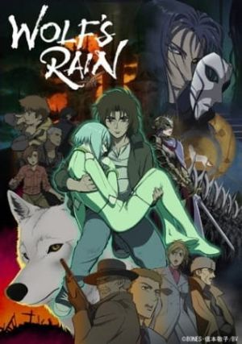

### Волчий дождь

«Волчий дождь» — это меланхоличная симфония угасающего мира, где под звуки призрачного Рая переплетаются судьбы последних волков, хранящих тайну исчезновения. В умирающем городе, медленно погружающемся в вечную зиму, миф о Райском цветке становится последней надеждой для существ, обречённых на одиночество.

Четверо волков, чьи жизни пронизаны травмой и потерей, образуют хрупкую стаю:

- Кибэ, альфа-самец, ищущий своё предназначение в мире, где его сородичи стали легендой

- Цумэ, предавший свою стаю из-за трусости и обречённый носить это клеймо

- Хигэ, невольный предатель, заманивающий товарищей в ловушки своим доверием к людям

- Тобоэ, живший в образе прирученной собаки и отрицающий свою природу

Их путь осложняется встречей, которая становится квинтэссенцией всей трагедии волчьего рода: старик-охотник, потерявший семью от клыков волков, и его верная спутница — собака Блю, не подозревающая о своей волчьей крови. Эта пара — живое воплощение разрыва между двумя мирами. Охотник, выкорчевавший из сердца всё, кроме ненависти, и его единственный друг, несущий в себе сущность его заклятых врагов. Их драма зеркально отражает внутреннюю борьбу самой стаи: каждому из волков приходится делать выбор между инстинктом и привязанностью, свободой и верностью. Когда правда о Блю раскрывается, это становится моментом краха для обоих: для старика — крушение всей системы мщения, ради которой он жил, для Блю — экзистенциальный кризис существа, не знавшего, кто она на самом деле.

Финал обретает масштаб античной трагедии: природа нажимает кнопку перезагрузки, погружая мир в ледниковый период. Человечество, заплатившее за свою гордыню уничтожением, получает не заслуженный шанс — возможность построить новый мир из пепла старого. «Волчий дождь» становится поэтическим размышлением о том, что даже в момент тотального конца сохраняется надежда на возрождение — не как награда, а как дар, данный вопреки всем грехам и заслугам.

