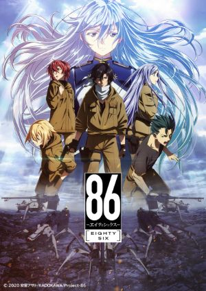

### Восемьдесят шесть (1, 2 часть)

«Восемьдесят шесть» — это не просто военная драма, а виртуозная экзистенциальная симфония о выборе, достоинстве и поиске смысла на краю гибели. Аниме достигает редкого баланса, где каждая сцена — это одновременно тактильное напряжение боя и глубокая философская притча.

Первая часть знакомит нас с Республикой Сан-Магнолия, ведущей войну на уничтожение с Легионом — армией автономных боевых машин. Чтобы избежать потерь среди своего «цветного» населения, государство отправляет на верную смерть «восемьдесят шестых» — бесправных жителей окраин, не признавая их даже людьми. На этом фоне разворачивается главный диссонанс: между наивным идеализмом майора-куратора Лены Мелизе, верящей в устав и гуманность, и мрачной, выстраданной моралью элитного отряда «Джаггернаутов» во главе со Жнецом Шином Надзэном. Их диалоги — словно разговор взрослого, видевшего смерть, с трёхлетним ребёнком, убеждённо рассуждающим о жизни. Однако этот контраст растворяется, когда Лена, осознав чудовищную правду о системе, сталкивается с её цинизмом лицом к лицу: официальные сводки голосят о «нулевых потерях», пока её подопечные теряют друзей и наконец принимают последний приказ — уйти вглубь территории врага на верную смерть. Её отчаянный, бессмысленный бег по улице города, словно она может догнать уходящих, становится символом разбитых иллюзий и зарождения новой, стоической верности. Верности их выбору, их принципам и своему обещанию: что будет помнить этих героев и однажды сможет их догнать.

Вторая часть переносит выживших «Восемьдесят шестых» в Федерацию — не идеальную, но гуманную альтернативу тирании Сан-Магнолии. Здесь их встречают не только как героев, а как трагических детей, заслуживающих жалости и покоя. Их молчаливое, но непоколебимое сопротивление этой жалости в конечном итоге заставляет окружающих увидеть в них не жертв, а воинов. Решающей становится сцена, где юная Фредерика, с мудростью не по годам, открыто порицает самого президента, защищая их право на собственный выбор — вернуться на поле боя. Именно здесь психологический портрет Шина обретает пугающую глубину: его дар Жнеца — это проклятие вечного хранителя павших, обрекающее его слышать голоса мертвецов, ставших частью Легиона. Его одиночество — не физическое, а экзистенциальное. Состояние Шина зеркально отражается в образе бывшего рыцаря Кирии Надзэна, чья слепая ярость после утраты смысла — это тень пути, ожидающего самого Шина, если он не найдёт опоры. Шин  оказывается на грани, почти поглощённый голосами мертвецов, а в особенности голосом Кирии. Он настолько глубоко погружается в эту тьму, что начинает как завороженный повторять за Кирией его слова: "Я убью тебя! Я убью тебя!". И только непоколебимая поддержка товарищей и сердечность Фредерики, отправившейся вопреки всем приказам на поле боя, становятся его первым якорем спасения.

Финал становится торжеством не оружия, а обретённой воли. Шин находит силы жить, когда его команда вопреки всему остается с ним, а на поле боя он встречает повзрослевшую Владлену, верную своему обещанию и своим принципам. Их финальная встреча, где она, уже командир особого отряда, слышит его голос и наконец видит лицо, — это не столько воссоединение, сколько момент взаимного признания двух людей, прошедших через ад и оставшихся верными себе и друг другу. «Восемьдесят шесть» утверждает, что даже в мире, лишённом справедливости, последней и главной свободой человека остаётся его экзистенциальный выбор — как жить, как сражаться и за кого нести своё бремя до конца.

