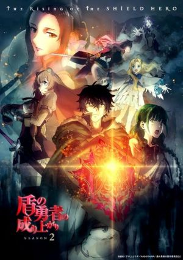

### Восхождение героя щита (1, 2, 3 сезон)

Аниме представляет собой изощрённую психологическую драму и тёмное фэнтези, замаскированное под классический isekai. В центре сюжета — не весёлое приключение, а история ожесточённого человека, прошедшего через предательство, ненависть и глубокую травму, который ценой невероятных усилий и моральных компромиссов отвоёвывает своё место в чужом и враждебном мире.

(1 сезон). Наофуми Иватани, наряду с тремя другими юношами, призван в другой мир в качестве одного из Легендарных Героев, призванных спасти мир от Волн Катастрофы. Однако в отличие от других, получивших меч, копьё и лук, он получает лишь Щит — предмет, считающийся бесполезным. Система мира, общество и его «союзники» немедленно обращаются против него, отвергая его как обузу. Кульминацией становится чудовищное предательство: его обвиняют в преступлении, которого он не совершал, подвергают остракизму и оставляют одного в мире, полном смертельных угроз. Ожесточённый, циничный и охваченный жаждой выживания и мести, Наофуми вынужден идти по тёмному пути. Он покупает рабыню, зверочеловека Рафталию, видя в ней сначала лишь инструмент, способный сражаться вместо него. Его единственная цель — выжить и стать сильным, чтобы отомстить тем, кто его предал. Однако его суровая, но справедливая забота о Рафталии постепенно рождает между ними глубокую, трагическую связь, становясь первым проблеском человечности в его озлобленном сердце. Первый сезон — это история о падении и выживании любой ценой, где герой, которого мир сделал монстром, начинает свой долгий путь обратно к человечности.

(2 сезон). Второй сезон посвящён выходу из изоляции. Наофуми, доказавший свою силу и обретший небольшой круг верных союзников, более не одинок. Теперь его задача — не просто выживать, а противостоять самой Волне Катастрофы и раскрыть тайны этого мира. Он сталкивается с другими цивилизациями (племена зверолюдей) и другими героями из параллельных миров, чьи мотивы и цели кардинально отличаются от его собственных. Ключевой темой становится цена силы и ответственность за тех, кто последовал за ним. Его методы по-прежнему жёстки и прагматичны, но теперь он борется не только за себя, но и за жителей своей деревни, ставшей ему домом, и за признание прав угнетённых зверолюдей. Внутренний конфликт смещается с жажды мести на необходимость стать лидером, которого он сам никогда не видел в других. Он вынужден учиться доверию, стратегии и глобальному мышлению, понимая, что его личная вендетта — лишь часть огромной, многослойной игры, где ставкой является судьба всего мира.

(3 сезон). Третий сезон закрепляет трансформацию Наофуми из одиночки-мстителя в признанного лидера и ключевую фигуру в судьбе мира. Он вынужден активно участвовать в политике королевств, выступая защитником не только своих непосредственных подопечных, но и всего мира перед лицом общей угрозы. Его авторитет непререкаем, а сила Щита раскрывает новые, подчас пугающие возможности. Основной конфликт сезона — это окончательное принятие своей роли. Мир больше не видит в нём изгоя, но это накладывает на него бремя колоссальной ответственности. Он должен объединять бывших врагов, принимать невозможные решения и нести за них ответственность. Его отношения с Рафталией и другими спутниками проходят проверку на прочность, превращаясь из связи «хозяин-раб», «соратники» — в настоящую, крепкую семью. Сезон логически завершает первую глобальную арку, отвечая на главные загадки мира и Волн Катастрофы, и демонстрирует окончательное возрождение Наофуми: из сломленной жертвы обстоятельств — в Героя Щита, который, пройдя через тьму, нашёл своё настоящее призвание: не разрушать, а защищать.

