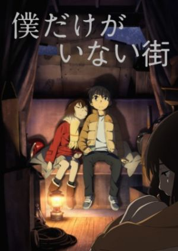

### Город, в котором меня нет

Аниме представляет собой напряжённый психологический триллер и научно-фантастическую драму, где фантастический концепт становится инструментом для исследования вины, фатализма и экзистенциального ужаса обычного человека перед лицом неисправимой трагедии. В центре сюжета — Сатору Фудзинума, неудавшийся мангака, чья пассивная жизнь рушится в один миг, когда его мать становится жертвой загадочного убийцы, а его самого объявляют в розыск.

Спасаясь бегством, Сатору невольно пробуждает в себе способность к перемещению во времени (Revival), которая на этот раз возвращает его в детство. Он получает шанс переписать историю, предотвратив цепь событий, которые привели к гибели его одноклассниц и его матери. Основной конфликт произведения — это не столько охота на маньяка, сколько внутренняя битва Сатору: сначала с собственной пассивностью, а затем — с превратностями судьбы его одноклассников.

Сила аниме — в блестящем раскрытии второстепенных персонажей, чьи судьбы сплетаются в единый трагический клубок. Каори Яширо, учитель, чья доброта скрывает изнанку невыносимого одиночества и внутренней пустоты, становится живым воплощением идеи о том, как одиночество и личные демоны способны породить абсолютное зло. При этом его образ лишён клешированого злодейства; это глубоко трагическая фигура, вызывающая одновременно и ужас и жалость. Подруга детства Сатору, Кайри Кобаяси, и её мать, раскрываются как жертвы не столько маньяка, сколько равнодушия окружающих и разлагающейся семейной системы. Каждое «Пробуждение» Сатору — это не просто изменение прошлого, а глубокое погружение в чужие травмы и мотивации, заставляющее его и зрителя пересмотреть первые впечатления о персонажах.

Нарастающий саспенс строится не на внезапных поворотах, а на леденящем душу осознании неотвратимости судьбы и хрупкости человеческих связей. Финал, в котором Сатору ценой невероятных усилий разрывает порочный круг, становится горьким триумфом. Он спасает жизни, но платит за это 15 годами комы, демонстрируя, что спасение требует тотальной жертвы, о которой он сам ничуть не жалеет. «Город, в котором меня нет» — это бескомпромиссное высказывание о том, что ответственность за чужую боль начинается с готовности увидеть её и вмешаться, а настоящее мужество заключается не в обладании силой, а в готовности нести её тяжелое бремя.

