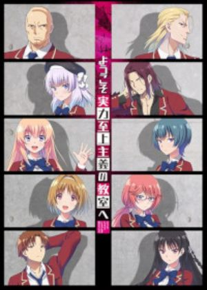

### Добро пожаловать в класс превосходства (1,2 сезон)

Аниме представляет собой интеллектуальную психологическую баталию, где школьные классы становятся полем для безжалостной социальной и стратегической войны. В центре сюжета — загадочный и гениальный Киётака Аянокодзи, чьё стремление к ничем не примечательной жизни сталкивается с жёсткой системой, вынуждающей его раскрыть свой истинный потенциал.

(1 сезон). Знаменитая академия «Кедо Икусей» — это высокотехнологичный социальный эксперимент, где ученики разделены на классы от A до D в зависимости от их «качества». Система поощряет безжалостную конкуренцию. Киётака Аянокодзи, внешне бесчувственный и асоциальный ученик, попадает в худший класс — D, «класс дефективных». Его намерение пожить спокойной школьной жизнью рушится, когда он осознаёт суть системы: слабых отчисляют. Постепенно Аянокодзи начинает манипулировать событиями из тени, используя свой невероятный аналитический ум. Главный вызов классу D бросает Какэру Рюэн — жёстокий и прагматичный лидер класса C, который первым признаёт в них угрозу и начинает открытую войну, используя грубую силу и шантаж. Аянокоджи, используя своих одноклассников — лидера  Сузуне Хорикиту и импульсивного Кэна Судо, — системно разбивает планы Рюэна, демонстрируя превосходство интеллекта над грубой силой. Первые победы не только спасают класс от отчисления, но и начинают менять его внутреннюю динамику.

(2 сезон). Игра обостряется и выходит на новый уровень. Главным антагонистом сезона становится лидер класса C, Какэру Рюэн — блестящий тактик, идущий к цели через шантаж, запугивание и безжалостность. Его цель — выявить «кукловода» из класса D, стоящего за их победами. Аянокодзи, втянутый в эту борьбу, вынужден действовать активнее, находя себе новых «пешек». Ключевой из них становится Кэй Каруидзава — популярная девушка, скрывающая глубокую травму. В ходе циничной манипуляции Аянокодзи провоцирует жестокие издевательства над ней, чтобы обнажить её слабость и проявить свою тёмную, почти дикую природу. Однако, сделав её своим главным инструментом, он одновременно даёт ей опору и надежду на избавление от прошлых обид.

Сезон движется к кульминации — финальной конфронтации с Рюэном, который предлагает сразиться на его «поле жестокости». Аянокодзи принимает вызов, чтобы разгромить противника и снова уйти в тень, отведя от себя подозрения. Его тотальная победа в этом противостоянии заставляет Рюэна признать своё поражение. Его тотальная победа в этом противостоянии заставляет Рюэна признать своё поражение. Однако триумф недолог: в самом конце гениальная лидер класса А, Арису Сакаянаги, узнавшая, что Аянокодзи — продукт печально известного проекта «Белая комната», сама бросает ему вызов, намереваясь сокрушить его в доказательство своего превосходства.

