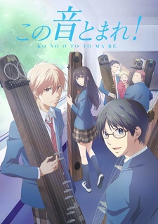

### Задержи этот звук! (1, 2 сезон)

«Задержи этот звук!» представляет собой не музыкальное аниме в привычном смысле, а тихую, сосредоточенную драму о травме и её преодолении через искусство. Здесь кото становится не просто инструментом, а языком, на котором сломанные люди учатся говорить о своих истынных чувствах. В его центре — не соревнование и не виртуозность, а медленный, мучительный процесс сборки себя из осколков через совместное творчество. Это история о том, как звук, рождённый из несовершенства, может стать целительным именно потому, что он честен.

Первый сезон закладывает фундамент этого пути, представляя коллектив. Неуверенный глава клуба, чья нерешительность — броня против страха снова оказаться униженным; брошенная матерью виртуоз, чьё мастерство выросло из одиночества и стало стеной; компания хулиганов, чья агрессия — единственный известный им способ защитить свою уязвимость; девочка-«подстрикала», чьи интриги лишь поиск искренности и принятия. Каждый из них приходит в клуб со своей раной, и каждый поначалу видит в другом лишь помеху. Их объединение — не мгновенная химия, а постепенное, неуклюжее сближение через общее дело, где неудачи становятся не поводом уйти, а причиной остаться.

Центральный конфликт первого сезона — это столкновение между желанием спрятаться и потребностью быть услышанным. Персонажи учатся сочувствию не через слова, а через звук: они слушают друг друга, подстраиваются под чужой ритм, учатся вовремя замолчать и вовремя вступить. Кото, с его требованием точности и дисциплины, становится идеальным инструментом для этого урока. Музыка здесь — не фон, а поле боя, где каждое неверное движение обнажает слабость, и одновременно — становится пространством, где эта слабость может быть принята.

Второй сезон углубляет эту динамику, переводя её из плоскости выживания в плоскость выражения. Если первый сезон был о том, чтобы просто остаться вместе, то второй — о том, чтобы через музыку сказать то, что нельзя сказать словами. Участники клуба уже не просто играют; они ищут свой голос, свою интонацию, своё право на ошибку. Их успехи на этом поприще — не триумф вундеркиндов, а результат упорства, которое рождается из доверия друг к другу. Ключевую роль здесь играют наставники: молодая учительница, передающая технику, и школьный учитель, чей талант музыканта и режиссёра позволяет увидеть в их несовершенной игре не набор ошибок, а живое дыхание. Они не лепят из них идеальных исполнителей — они помогают им услышать себя.

В итоге «Задержи этот звук!» приходит к простому, но глубокому выводу: исцеление не происходит в одиночку. Оно рождается в пространстве между людьми, которые согласились слушать друг друга, даже когда звучит фальшь. Кото требует точности, но жизнь требует гибкости — и именно в этом зазоре между идеалом и реальностью и рождается подлинное искусство. Каждый из участников клуба остаётся сломанным по-своему. Но их общая игра, их попытка выразить свои чувства через струны, делает эти трещины не изъяном, а источником силы. Ибо настоящий звук — это не тот, что звучит безупречно, а тот, что задерживается в сердце, потому что был сыгран от чистого сердца.
