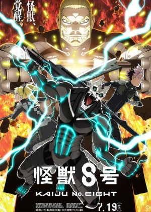

### Кайдзю номер восемь (1,2 сезон)

«Кайдзю номер 8» — это динамичный боевик, который под яркой оболочкой сражений с монстрами скрывает немного нелепую, неглубокую попытку исследования темы самоидентичности. Аниме балансирует между искромётным юмором и моментами человеческой уязвимости, хотя режиссуре не всегда удаётся передать заявленный драматизм. Аниме подойдет тем, кто ценит простой эмоциональный юмор и экшен, выполненный с отсылками к стилистике "Ванпанчмена".

Первый сезон знакомит нас с Кафкой Хибино — неунывающим мужчиной, годами безуспешно пытающимся вступить в Силы Обороны. Его многолетние провалы не сломили дух, но превратили в символ упрямого оптимизма. Ирония судьбы настигает его, когда он, спасая другого, превращается в то, с чем хотел бороться всю жизнь — в кайдзю. Кульминацией становится бой с главой СО, где Хибино, будучи не в силах контролировать охватившую его ярость, пронзает себе грудь — первый осознанный акт страха перед собственной силой, семя будущей внутренней борьбы.

Второй сезон углубляет тему, показывая, что сомнениям подвержены все. Кафка сталкивается с парадоксом: в решающий момент он не может использовать силу кайдзю из-за страха потерять контроль и причинить вред товарищам. Ключевой становится сцена с Шиномией Кикору, выполненная, впрочем, довольно шаблонно, которая помогает ему осознать, что вера в своих соратников — не слабость, а необходимость. Параллельно Рэно Итикава повторяет ошибку главного героя с обратной стороны, пытаясь в одиночку нести бремя ответственности, пока команда не доказывает ему, что его ценность не сводится к жертвенности.

Отдельным, но ключевым нарративным пластом сезона становится осознание новой реальности: с появлением разумных гуманоидных кайдзю люди из охотников сами превратились в добычу. Эти кайдзю не просто атакуют — они дотошно изучают психологические и тактические слабости своих жертв, превращая человеческий разум из главного оружия в основную уязвимость. Эта концепция, однако, так и не получает по-настоящему глубокого развития, так как аниме заканчивается посреди сражения.

Финал аниме становится логическим завершением этого пути. «Кайдзю номер 8» утверждает, пусть и шепотом, что истинная сила рождается не из отсутствия страха, а из мужества принять свои «уродливые» и пугающие части. Подлинный монстр — не тот, у кого есть клыки и когти, а тот, кто позволяет своим сомнениям разъедать себя изнутри. В мире, где враг может использовать твои слабости против тебя, самым мощным щитом становится целостная личность, а самым грозным оружием — товарищи, готовые прикрыть твою спину.

