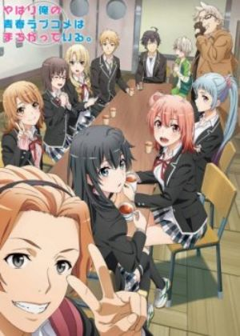

### Как и ожидалось, моя школьная романтическая жизнь не удалась (1, 2, 3 сезон)

(1 сезон) Хачиман Хикигая семнадцатилетний парень с нигилистическими и пессимистическими взглядами. Его стремление под давлением прошлых травм изолироваться от социальной жизни порождает не только действия, что отдаляют его от других, но и сам характер. Он весь свой незаурядный ум направляет на эту цель. Шизука Хирацука, учитель, стремящаяся помочь парню, привлекает его в «Клуб волонтёров», куда уже входит очаровательная и крайне умная Юкино Юкиношита. Преподаватель решила, что каждому из этих отшельников требуется помощь. Юкиношита - гениальная и живущая под гнетом своей семьи, привыкла к роли эгоистичной и нелюдимой куклы, Хикигая, в свою очередь, с противоречивыми пессимистическими взглядами. Последней участницей клуба становится жизнерадостная Юи, которой не посчастливилось влиться в эту странную группу. Постепенно через совместные дела они лучше начинают понимать друг друга и возникает некоторая сплоченность, за которой герои, хоть и с внешним пренебрежением, но с внутренним желанием, возвращаются в клуб снова и снова. Сезон насыщен нигилистическим и черным юмором.

(2 сезон) Этот сезон более медленный по развитию. Главные герои впервые задумываются, что им хорошо в компании друг друга. Но признать это они не могут, иначе рухнет их образ мира, который они воспитывали в себе годами. Именно здесь начинаются первые осознания общности и привязанности друг к другу. Каждый по-своему начинает чувствовать своих друзей и ощущать как через них происходят изменения. Каждый по-своему начинает взрослеть через цепочку ошибок, разочарований.

(3 сезон) Кульминация истории, а так же внутренних конфликтов каждого персонажа. Хикигая уже понял, что девушки из клуба стали ему дороги, он желает им добра, но его старые методы причиняют боль уже не только ему, но и им. Это порождает серьезную дилемму, которая заставляет пересмотреть его взгляды на жизнь. Юкиношита - осознав себя зависимой от окружения пытается стать более самостоятельной, что отдаляет ее от друзей и ранит их. Ситуация все больше осложняется для нее провокациями со стороны семьи. Юи - полюбившая Хикигая, не знает как быть, так как осознает, что его чувства и чувства Юкиношиты взаимны. Её противоречия между эгоизмом (борьбой за чувства к парню) и дружескими чувствами (желанием блага обоим друзьям) вступают в явное противоборство. Каждый из них уже не может оставаться прежним и вынужден вырасти. Здесь аниме теряет жанр коммедии и становится драмой с романтикой. Сериал логически завершается решающим шагом каждого героя на путь более взрослого и искреннего понимания себя и будущей жизни.

