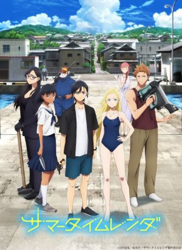

### Летнее время

Сильные стороны аниме — психологически насыщенные нарративы второстепенных персонажей, где мотивация каждого вырастает из личной трагедии. Слабость — в образе Шимпея, чьи просчёты выглядят не как развитие, а как сценарные дыры, подменяющие психологическую глубину хаотичным экшеном. Аниме ценит персонажей, но не верит в логику их главного героя.

Центральный конфликт аниме строится не столько на борьбе с «тенями», сколько на цикле саморазрушения, запущенном травмой прошлого. Остров Хотори, становится метафорой неразрешённых долгов: Хайме, беловласая девочка - «мать теней», олицетворяет боль утраты, превратившуюся в насилие, а священник Шидо использует её отчаяние для «очищения» человечества. Система петель здесь — не инструмент спасения, а ловушка для тех, кто не может отпустить боль.

Психологическая дуга Аджиро Шимпея подчёркивает главный сценарный просчёт: герой позиционируется как стратег, но его решения часто иррациональны даже в рамках собственной логики сюжета. Например, он игнорирует факт того, что информация из параллельной петли доступна соперникам и потому допускает уже безвозвратную гибель Нагумо. Его «ум» — иллюзия: вместо логики он действует на импульсах, создавая кризисы, которые вынуждены исправлять другие (например Юшуо, жертвующая собой из-за его просчётов). Единственная его сила — предприимчивость, но она не компенсирует фундаментального непонимания правил игры.

Глубина раскрывается через второстепенных героев. Мио — не просто «сводная сестра», а символ принудительной жертвенности: её готовность умирать ради Шимпея вырастает из детской травмы одиночества. Нагумо Хидзуру (писательница, скрывающаяся под псевдонимом Рюноске), скрывает под сарказмом вину за гибель младшего брата — её мотивация бороться с тенями рождается не из героизма, а из попытки искупить прошлое. Даже Хайме, чья месть кажется безумной, движима детским горем: потеряв близких, она создаёт «семью» из теней, чтобы быть всегда с ними. Каждый персонаж — это история о том, как боль формирует выбор, а не выбор формирует личность.

Философский стержень аниме — вопрос: можно ли разорвать цикл насилия, не приняв его частью себя? Шидо, видя человечество как «болезнь», пытается стереть прошлое, но его методы копируют жестокость тех, кого он осуждает. Аниме не даёт ответа, лишь показывая, что память — и бремя, и спасение: герои побеждают не силой, а через принятие утраты как условия существования.

