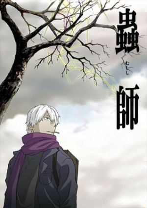

### Мастер муси

Аниме представляет собой медитативную философскую притчу о границе между жизнью и небытиём, где «муси» — не монстры, а первичная форма жизни, лишённая цели, разума и зла, но способная нарушить хрупкое равновесие человека с миром. Его центральный конфликт — столкновение человеческой логики бытия, построенной на смысле и выживании, и природной: безличной, неумолимой, где жизнь течёт как дыхание, без начала и конца.

Гинко — не герой, а «наблюдатель на границе». Он видит, слушает, интерпретирует. Его роль — помочь человеку осознать: то, что с ним происходит, — лишь следствие пересечения двух миров. Каждая история — это маленькая катастрофа равновесия: ребёнок, застрявший между сном и явью; деревня, потерянная во времени; зрение, превратившееся в память. Муси не причиняют зла — они просто существуют. Им лишь нужна благоприятная среда для существования, которую нередко создают сами люди. В каждой истории — своя философская глубина, а трудности, порождённые муси, зачастую являются следствием внутренних противоречий главных героев. Гинко выступает не только как посредник, но и как психотерапевт: он помогает не избавиться от муси, а обрести гармонию через принятие желания, осознание его невозможности или признание чужой боли. Его слова — не диагноз, а зеркало. Ярким примером служит история с женщиной, чей дом наполнился «звучащими» муси: Гинко не уничтожает их, а помогает ей осознать, что её глубокая, невысказанная скорбь по ушедшему мужу стала тем резонансом, что привлёк их, и только принятие своей боли и прощание с прошлым позволит вернуть в её жизнь тишину.

Нарративная структура сезонов отражает этот подход. Первый сезон — это цикл законченных притч, капсул человеческого опыта, где Гинко предстаёт загадочным странником. Второй сезон смещает фокус, углубляясь в его собственное прошлое. Трагедия, связанная с его наставницей, истоки его искусственного глаза и причина его изгнания раскрываются не как приключенческий бэкграунд, а как ключ к пониманию его философии. Его нынешняя отстранённость и принцип невмешательства предстают не врождёнными чертами, а результатом выстраданного урока о цене, которую платит тот, кто пытается силой изменить естественный ход вещей.

Психологическая глубина раскрывается в звенящей тишине. Персонажи не кричат от боли — они растворяются в ней. Их травмы — не физические, а экзистенциальные: потеря связи со временем, с телом, с памятью, с собственным лицом. Мать, чей ребёнок больше не растёт, не требует справедливости — она просто живёт с невозможным. Старик, видящий прошлое вместо настоящего, не хочет возвращаться — он уже выбрал забвение, чтобы остаться в свете тех, кого любил.

Форма аниме — антипод традиционному сюжету. Нет нарастающего саспенса, нет кульминации, нет триумфа. Есть ритм: вход, наблюдение, понимание, уход. Гинко не меняется — он сохраняется. Его трансформация — в постоянстве: он остаётся тем, кто может ходить между мирами, не растворяясь ни в одном из них. Его белые волосы, искусственный глаз, зависимость от табака — не детали, а символы: он сам — гибрид, человек, который больше не принадлежит полностью к людям, но и не стал одним из муси.

Аниме достигает редкой высоты — оно сжимает глубокую историю в каждой серии, наполняя зрителя состоянием созерцательной неспешности. Его сила — в отказе от героики, в уважении к тайне, в способности говорить о невыразимом через образ, свет и тишину.

