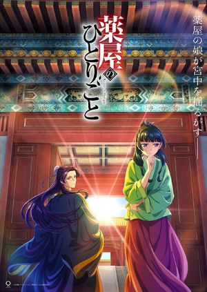

### Монолог фармацевта (1, 2 сезон)

«Монолог фармацевта» — это изящное историческое полотно, сотканное из тонких политических интриг, медицинских тайн и тихой революции личности в жёстких рамках дворцовой иерархии. Действие разворачивается в Запретном городе, где внешняя красота и роскошь скрывают яды, зависть и смертельные болезни, а фармацевтика оказывается самым изощренным оружием.

Первый сезон знакомит нас с Мао Мао — девушкой-вундеркиндом, обладающей феноменальным обонянием и энциклопедическими познаниями в фармакологии. Для неё человеческие эмоции остаются такой же непостижимой наукой, как для других — высшая математика. Её социопатичность, неспособность распознавать и разделять чувства, становится источником изощрённого чёрного юмора: с научным интересом она может обсуждать симптомы смертельного отравления, оставаясь совершенно равнодушной к панике и слёзам окружающих.

Оказавшись в гареме в качестве служанки, она обнаруживает, что её уникальные навыки — это не только способ выжить, но и мощное оружие в придворной войне. Под внешним покровительством проницательного и загадочного евнуха, господина Жэньши, Мао Мао начинает расследовать цепь загадочных недугов, поражающих обитателей дворца. Каждое её действие — это тонкое балансирование между долгом служанки и маниакальным увлечением ядами. Её расследования обнажают системный порок, ярко проявившийся в истории с приёмным отцом: в мире, где женское здоровье становится политическим инструментом, а диагнозы ставятся по указке свыше, подлинная медицина превращается в государственное преступление.

Второй сезон усложняет нарративную динамику, выводя отношения Мао Мао и господина Жэньши на качественно новый уровень. Из связи покровителя и подопечной они постепенно превращаются в стратегических партнёров, чей союз основан на интеллектуальном равенстве и взаимном доверии, с постепенно проступающим романтическим подтекстом. Параллельно Мао Мао начинает невольный путь познания чуждых ей чувств: через общение с подругами-служанками, сочувствие к наследнице императора, терпящей постоянные побои, и трагедию наложницы Сяо Лань — её первой настоящей подруги, которая собственным примером показала, что такое материнская жертвенность.

Философским стержнем аниме становится исследование природы власти и исцеления. «Монолог фармацевта» утверждает, что подлинная сила заключается не в титулах или положении, а в знании, компетентности и верности своим принципам. Личный кабинет-аптека Мао Мао, который она обретает в финале, становится крошечным оплотом рациональности в сердце иррационального и жестокого мира. Аниме оставляет нас с мыслью, что даже в самых жёстких иерархиях один человек, вооружённый знанием и мужеством, способен стать катализатором тихих, но необратимых перемен.

