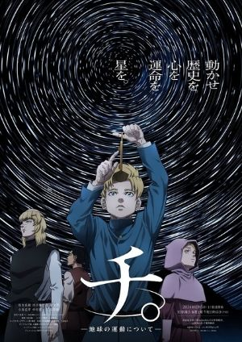

### О движении Земли

«О движении Земли» — это не историческая хроника, а философская симфония в форме аниме, где научное открытие становится манифестом о свободе человеческого духа. Аниме разворачивает перед зрителем панораму эпохи, где знание было одновременно и священным даром, и смертельным преступлением, а поиск истины требовал готовности пожертвовать всем.

Основная линия повествования — это эстафета знания, которую великие умы передают через поколения, словно тайное завещание. Гелиоцентрическая теория здесь становится не просто астрономической моделью, но символом инакомыслия и свободы мысли. Каждый из учёных — от скрывающего свои исследования монаха до смелого профессора — понимает, что, приняв эту эстафету, он подписывает себе смертный приговор. Но цепь не прерывается, потому что жажда познания оказывается сильнее инстинкта самосохранения.

Параллельно аниме исследует сложный узел моральных дилемм, делая их доступными и пронзительными:

- Вера и знание — не антагонисты, а два языка, на которых человечество пытается объяснить мир. Аниме задаётся вопросом: может ли научное открытие быть актом благочестия, раскрывающим величие Божьего замысла?

- Цена прогресса — оправдано ли развитие науки, если её плодами воспользуются для войн и угнетения? Имеем ли мы право отказываться от знаний, которые могут спасать жизни, даже если общество к ним не готово?

- Невежество как рабство — аниме показывает, что отсутствие доступа к информации является формой современного рабства. Безграмотность — это не недостаток образования, а оковы на сознании, и борьба за знание приравнивается к борьбе за освобождение человечества.

Отдельного внимания заслуживает трагическая фигура инквизитора. Начинающий как фанатичный исполнитель воли системы, он сломлен, когда его действия приводят к гибели собственной дочери. Его трагедия в том, что он стал слепым орудием в чужой игре, где подлинной причиной гонений оказалась не угроза вере, а чья-то личная неприязнь и политические интриги. Его раскаяние и потеря — это самый горький упрёк системе, в которой человеческие судьбы становятся разменной монетой в борьбе амбиций.

«О движении Земли» поднимается над жанром исторической драмы, становясь вневременным высказыванием о том, что любая цензура и подавление инакомыслия — это не защита устоев, а страх системы перед вопросом, на который у неё нет ответа. Истинная вера, как и истинная наука, не боится вопросов — она рождается в мужестве искать на них ответы, даже когда вся вселенная кажется враждебной. Аниме напоминает: прогресс — это не триумф техники, а цепь личных трагедий и мужественных выборов, где каждое «я знаю» оплачено чьей-то тоской, болью и кровью.

