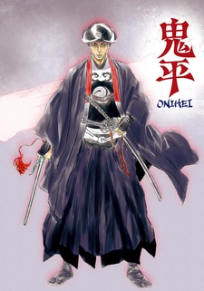

### Онихэй

«Онихэй» представляет собой не исторический детектив в привычном смысле, а галерею человеческих судеб, где каждый эпизод — это притча о выборе, а главный герой, Хэйдзо Хасэгава, выступает не столько следователем, сколько зеркалом, в котором преломляются чужие жизни. В центре повествования — не раскрытие преступлений, а исследование природы справедливости, вины и искупления в мире, где грань между добром и злом проходит не через закон, а через человеческое сердце. Хэйдзо, прозванный «Демоном» за свою беспощадность к отпетым бандитам, парадоксальным образом оказывается самым человечным персонажем — его жестокость не самоцель, а инструмент защиты тех, кто ещё способен на исправление.

Судьба каждого персонажа в «Онихэй» — это череда выборов, и аниме с почти документальной беспристрастностью показывает, как эти выборы формируются под давлением обстоятельств, прошлого и человеческих слабостей. Хэйдзо, сам прошедший путь от распущенного юнца до главы стражи порядка, понимает это лучше других. Его метод — не просто карать, а видеть в преступнике человека, чья жизнь могла сложиться иначе. Именно поэтому он с сочувствием относится к тем, кто оступился по нужде или отчаянию, и абсолютно беспощаден к тем, для кого зло стало единственным языком общения с миром.

Одним из самых пронзительных примеров того, как «Онихэй» переплавляет частную трагедию в экзистенциальную притчу, является история Исотаро из десятого эпизода — юноши, чья жизнь рушится под тяжестью чужой жестокости и собственного молчания. Исотаро работает помощником управляющего в бумажной лавке и становится объектом травли со стороны нового хозяина. Он не рассказывает об этом ни приёмным родителям, ни своему биологическому отцу, пожилому вору на пенсии, который когда-то оставил сына на попечение друзей, сочтя себя неспособным быть хорошим отцом. В этом молчании — весь ужас ситуации: Исотаро предпочитает скрывать правду, потому что боится разрушить образ успешного сына, который, как ему кажется, от него ожидают, или, возможно, потому что в глубине души считает, что заслуживает такого обращения.

Когда хозяин лавки подставляет Исотаро, обвинив его в краже, юноша совершает самоубийство — акт, который одновременно является его окончательной капитуляцией. Смерть Исотаро запускает цепную реакцию: его приёмные родители кончают с собой, бросившись в реку, а биологический отец, узнав о случившемся, использует построенный им когда-то в лавке потайной ход, чтобы привести банду воров и вершить возмездие за смерть сына. Трагедия разворачивается стремительно, как лавина, и Хэйдзо лишь свидетельствует этому, не в силах вмешаться. Эта история — квинтэссенция аниме: преступление здесь рождается из отчаяния, унижения и той тихой ярости, что зреет в человеке, которому не оставили иного выхода.

Хэйдзо в этой истории не вершит правосудие — он наблюдает, и в этом наблюдении заключён его собственный суд. Он видит, как система, будь то социальная иерархия или человеческая жестокость, ломает тех, кто мог бы жить иначе. И именно это видение, а не меч, делает его «Демоном» — демоном, который знает цену каждому выбору, потому что сам когда-то стоял на краю и был спасён слезами случайного наставника.

В итоге «Онихэй» приходит к тихому, почти будничному выводу: справедливость не торжествует и не терпит поражение — она просто существует как ежедневный, изнурительный труд различения — где зло, а где отчаяние, где вина, а где беда. Хэйдзо Хасэгава, глава стражи, человек с руками в крови и сердцем, открытым для чужой боли, олицетворяет парадоксальную истину. Его сила — не в безошибочности, а в способности видеть человека даже в том, кого общество уже списало со счетов. Ибо в мире, где каждый выбор оставляет шрам, истинный демон — тот, кто понимает, когда нужно карать, а когда миловать или же безмолвно остаться в стороне.
