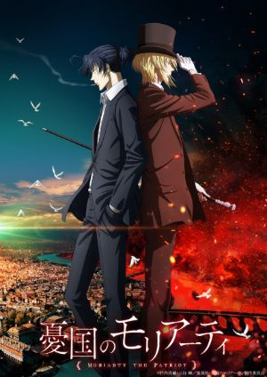

### Патриотизм Мориарти

Аниме представляет собой социально-психологическую драму, которая погружает зрителя в сердце Викторианской Англии, где классовая система — не просто пережиток прошлого, а живой организм, пожирающий чужие судьбы. Здесь бедность наследуется как генетический код, а благородство зиждется на костях тех, кто остался по ту сторону светского блеска. В центре этого противостояния — Виллиам Джеймс Мориарти, гений математики с манерами аристократа и душой революционера, который видит в преступлении не порок, а единственный доступный ему инструмент хирургического исправления мира.

Его харизма — в парадоксальном сплаве безграничной доброты к жертвам системы и леденящей безжалостности к её главным бенефициарам. Он может выслушать горькую исповедь служанки, а на следующее утро — хладнокровно устранить лорда, превращающего жизни бедняков в сафари для собственной забавы. Каждое его преступление — это не просто акт возмездия, но и тонкий надрез на теле системы: он использует коррупцию и жадность аристократии как оружие против неё самой, словно врач, применяющий яд больного организма для его же исцеления. Эта «хирургия» достигает писательской изощренности в эпизоде с фальшивыми благотворительными фондами, где Мориарти не просто разоблачает лицемерие, а демонстрирует, как сама система превращает отсутствие образования в смертельный приговор. Переосмысливая дилемму «Венецианского купца», он с детства знает: иногда единственным ответом на институциональное насилие может быть не милосердие, но возмездие, становящееся первым выстрелом в войне с устоявшимся порядком.

Однако во втором сезоне фокус смещается с социальной хирургии в сторону эффектного, но пустого экшена. Появление таких фигур, как Ирен Адлер и Мэри Морстон, служит лишь данью канону, не обогащая ни основную идею, ни характеры главных героев. Их присутствие превращается в декорацию, отвлекающую от главной драмы.

Главной же неудачей аниме становится нераскрытая внутренняя трагедия самого Мориарти. Мы видим его гениальные расчёты и безупречную аранжировку, но нам почти не показывают цену, которую он платит за свою миссию. Его сомнения, его взгляды в зеркало, в котором отражается не спаситель, а палач, — всё это остаётся за кадром, проглядывая лишь намёком в финале. Когда он отказывается от жизни, слыша голос Шерлока, мы понимаем: он не может простить себе крови, пролитой ради справедливости. Но это прозрение приходит слишком поздно.

Нам остается лишь гадать, что истинная трагедия Мориарти в том, что он мог понять любого, но остался вечной загадкой для всех — до встречи с Шерлоком Холмсом.  Их связь —  это не соперничество, а встреча двух одиноких гениев, которые видят друг в друге искажённое отражение самих себя. И именно потому его финальная просьба — не слабость, а кульминация его философии. Он осознаёт, что стал тем единственным врагом, который способен объединить расколотый мир. Его смерть от руки единственного, кто его понял, — последнее и самое горькое уравнение в его плане. Аниме оставляет нас с пронзительной мыслью: иногда быть носителем света — значит сгореть дотла, чтобы осветить путь другим, и эта трагедия остается не понятой никем, кроме единственного друга, который стал твоим палачом по твоей же воле.

