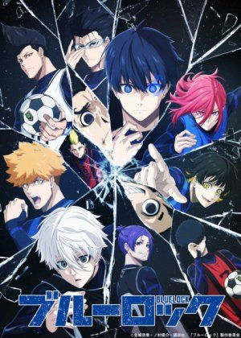

### Синяя тюрьма: Блю Лок

«Синяя тюрьма: Блю Лок» — это спортивная драма о футболе, с психологическим размышлением о природе таланта, где каждая тренировка, каждый матч и каждая капля пота становятся метафорой человеческого потенциала. Аниме разрушает романтические мифы о врождённом гении и жертвенном альтруизме, предлагая вместо этого жесткую истину: великие достижения рождаются, когда эгоизм становится осознанным инструментом роста, а удача — результатом встречи подготовленного разума с возможностью.

Центральная концепция «рационального эгоизма» раскрывается через Ичиносэ — гения, чья харизма основана на уверенности в своём предназначении. Для него футбол — не игра для болельщиков, а священное пространство, где личный голод к совершенству служит высшей цели: созданию самого красивого и эффективного футбола в мире. Его знаменитая фраза «Я не хочу, чтобы меня любили» — не призыв к изоляции, а отказ от ложной скромности. Он не жертвует собой ради команды; он требует от команды подняться до своего уровня, потому что верит: только через честное признание своих амбиций можно достичь того, чего не может ни один гений в одиночку. Истинная жертва здесь — не отказ от себя, а готовность переписать свою историю ради большего смысла.

Система «Блю Лока» становится лабораторией для исследования природы удачи. Тренер Эго не говорит о «везении» — он показывает, как создать его условия. Когда персонажи сталкиваются с кризисами (как падение Рёуси или провал Арсена), аниме демонстрирует: везение — это не подарок судьбы, а момент, когда годы безумного труда встречают единственный шанс. Сцена, где Ичиносэ объясняет: «Ты думаешь, я родился с этим дриблингом? Каждый мой шаг — это 10 000 повторений, которые никто не видел», — становится ключевой. Здесь разрушается иллюзия: удача без подготовки — просто хаос, а подготовка без удачи — трагедия невидимого труда. Только их союз превращает случай в судьбу.

Особую силу приобретает тема воспитания через отказ от сравнений. Многие персонажи приходят в «Блю Лок» с травмой «неудачника» (как Наги, считавший себя второсортным), но программа Эго учит их: сравнивать себя не с другими, а со своим будущим «я». Высочайшие устремления здесь — не стандарт для отчаяния, а ориентир. Когда Ичиносе видит талант в Рёуси, он не завидует — он видит в нём отражение своих возможностей. Это не соревнование, а диалог, где амбиции одного становятся топливом для роста другого. Даже провалы становятся ступенями: падение Наги в первом матче не убивает его — оно заставляет задать вопрос: «Что я готов отдать, чтобы никогда больше не чувствовать это?». Ответ становится его новой мотивацией.

«Синяя тюрьма» демонстрирует, что величие невозможно в одиночку, но и невозможно без рационального эгоизма и высоких устремлений. Истинный лидер, как Ичиносэ, не стирает себя ради других — он заставляет других увидеть в себе больше, чем они считали возможным. Удача здесь — не волшебство, а математика: титанический труд × правильный момент = прорыв. А самые высокие цели не унижают нас своим величием — они зажигают в нас огонь, когда мы перестаём сравнивать свои начинания с чужими результатами и начинаем видеть в каждом своём падении не конец пути, а координату на карте к вершине. В этом — главная победа аниме: оно превращает спорт в метафизику выбора, где каждый мяч — это шаг к тому, чтобы стать лучшей версией себя и зайти в этом настолько далеко, чтобы даже самому было удивительно, каких высот ты смог достичь.

