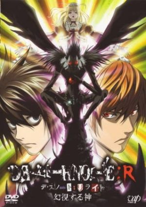

### Тетрадь смерти

«Тетрадь смерти» представляет собой детективный триллер и тотальную философскую притчу о природе власти, справедливости и экзистенциальной пустоте. В её центре — не интеллектуальная дуэль, а фундаментальный конфликт между абстрактным Законом и человеческим Эго, где божественный инструмент становится орудием нарциссического самоутверждения.

В начале произведения нам представляют Лайта Ягами — интеллектуально одарённую личность, изнывающую от экзистенциальной скуки мира, который он считает «гнилым». Однажды, в неспешной, ленивой прогулке он находит тетрадь, позволяющую убивать записав в нее лишь имя. Она олицетворяет чистейшую концепцию абсолютной власти, лишённой какой-либо ответственности перед обществом. Постепенно, Ягами начинает вовлекаться все более глубоко в мир власти над человеческими жизнями. Его мотивация — не стремление к справедливости, а жажда трансценденции: бегство от собственной человеческой ограниченности через обретение статуса божества. Первый акт повествования — это генезис «Киры», маски, которая постепенно поглощает личность Лайта, превращая его из скучающего гения в «трагического мессию», одержимого собственной непогрешимостью.

Его оппонент, L, выступает как воплощение чистого, безличного интеллекта. Их противостояние — это не битва добра и зла, а столкновение двух зеркальных нарциссизмов: бог, жаждущий признания, и детектив, одержимый решением идеального уравнения. Мир для них — гигантская шахматная доска, а человеческие жизни — разменные фигуры. Гениальность нарратива заключается в том, что Лайт, объявив войну преступности, сам становится её квинтэссенцией, а L, защищая закон, методично его попирает. Система и её разрушитель оказываются неразличимы в своих методах, что является изощрённой деконструкцией самой идеи «высшей цели».

Финальный акт олицетворяет окончательный крах личности. Лайт, пройдя путь от человека к божеству и от божества к преследуемому зверю, демонстрирует свою завершающую метаморфозу: он более не способен на человеческие эмоции, кроме ярости и страха. Его гибель — закономерный итог пути существа, которое, возомнив себя проводником высшего суда, оказалось рабом самой примитивной и разрушительной страсти — жажды признания.

В итоге, «Тетрадь смерти» приходит к фаталистическому выводу: абсолютная власть не развращает, а обнажает. Она не создаёт тирана, а служит катализатором, проявляющим истинную, часто уродливую, сущность личности. Это исследование абсурдной попытки навязать миру порядок через хаос, которая заканчивается не искуплением или победой, а горьким осознанием того, что любое божество, сотворённое человеком, неизбежно будет нести в себе все его пороки.

